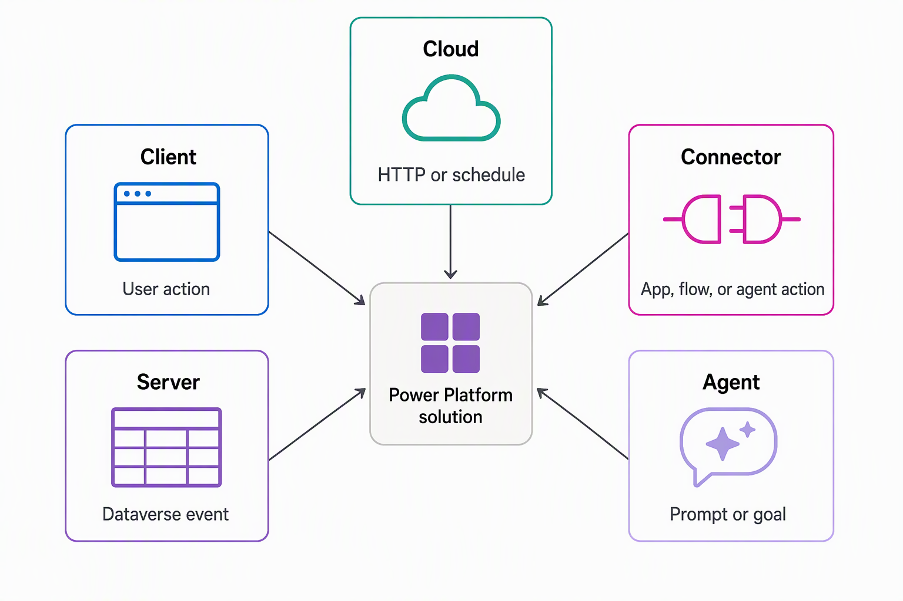

# Map where extension code runs and how it starts

The Introduction lays out the equipment-provisioning scenario and the full menu of extension options this module compares. Before you weigh specific technologies against each other, you build a mental model for where code runs and what starts it running. Later units build on that map when they compare specific options.

## Five extension runtimes: client, server, cloud, connector, agent

Every piece of extension logic lives in one of five runtimes: client, server, cloud, connector, or agent. Each runtime has its own physical home, its own constraints, and its own reason to exist. Recognizing which runtime a piece of logic belongs in is the first decision you make, long before you pick a specific technology.

Consider the equipment-provisioning system from the Introduction. An employee fills out a request in an app, so some logic runs right there in the app. Dataverse stores and enforces rules about requests, so other logic runs on the server, wherever a request record gets created, no matter which app or process creates it.

An external service tracks which devices are actually available, so logic that calls out to that service runs somewhere outside Dataverse entirely. A coordinator reviews and approves requests, and that approval conversation itself can be driven by an AI agent that reasons over the request. The following table places each runtime on the map and connects it to a piece of this scenario.

| Runtime | Where it executes | What initiates it | Example from the scenario |
| --- | --- | --- | --- |
| **Client** | In the browser or app runtime, on the user's device | A user action: opening a form, typing into a field, clicking a button | Validating that an employee enters a device identifier in the right format while completing a request |
| **Server** | On the Dataverse server, within the same transaction as the data operation | A Dataverse event: a message such as create, update, or delete firing against a table row | Enforcing eligibility rules every time someone creates a request record, regardless of whether the request comes from an app, a cloud flow, or an API |
| **Cloud** | On compute or services outside Dataverse | An HTTP call or a scheduled trigger | Checking live device availability from an external service, on a schedule or the moment a request is submitted |
| **Connector** | At the bridge between Power Platform and an external system | An action or request made through the connector by an app, cloud flow, or agent | Exposing the external availability service's operations so a cloud flow or agent can call them securely |
| **Agent** | In an AI-driven runtime that reasons over a goal, a conversation, or a set of instructions | A conversational prompt, a defined goal, or an event the agent monitors | Carrying a request through an approval conversation with the coordinator, or watching pending requests and prompting the coordinator automatically |

## Triggers: what starts each runtime

Where code lives and what starts it running are two separate questions, and conflating them is a common source of confusion when you first compare extension options. A runtime tells you where logic physically executes. A trigger tells you the signal that sets it running, and that signal looks completely different from one runtime to the next.

With client logic, a person is always behind the trigger: a click, a keystroke, a form opening. With server logic, the trigger is never a person directly. It's a message the platform raises whenever a data operation happens, whether a human, a cloud flow, or another system caused it.

That distinction matters in the scenario. An eligibility rule that only ran when an employee submitted a request through the app would miss requests created any other way. Placing that rule on the server, triggered by the event itself rather than by the app, keeps the rule consistent no matter how a request gets created.

Cloud and connector triggers sit in between. A cloud process reacts to an HTTP call or fires on a schedule. That means the nightly device-availability check and the on-demand check triggered by a new request can both exist as the same kind of cloud logic, with different triggers attached.

A connector doesn't trigger anything on its own. It exposes operations that something else, such as a cloud flow, an app, or an agent, decides to call.

Agent logic introduces a different kind of trigger altogether. Instead of a single discrete event, an agent responds to a goal or a conversation. It can keep reasoning across multiple steps, as when it guides a coordinator through approving a request rather than firing once and finishing.

## Server-side vocabulary: message, service, and event framework

Server-side logic in Dataverse comes with its own vocabulary. Recognizing these terms now gives you the footing you need when later units in this module go deeper into building extensions. You don't build anything with these terms yet, you place them on the map.

Every data operation in Dataverse, a create, an update, a custom business operation, is defined as a named *message*. Five more terms build out this vocabulary:

- **Organization service**: Defines these messages and the operations the platform supports.
- **Dataverse Web API**: Exposes that same catalog of operations over HTTP, as RESTful functions and actions. You can call the identical operations the organization service defines from almost any programming language.
- **Event framework**: Detects when one of these messages fires and lets you register custom logic to respond.
- **Plug-in**: The server-side code you register to respond to an event through that framework.
- **Custom API**: Lets you define an entirely new named operation, beyond the operations Dataverse ships with. Other logic can then call it the same way it calls any built-in message.

Together, these pieces describe how server-side logic connects to the platform, not how to write any one of them.

> 
> **Guiding question:** Think of a process you support, at work or in a system you know well. Which piece of its logic belongs on the client, which belongs on the server, and which depends on an external service or an AI-driven decision? Try placing each piece on the five-runtime map before you move on.

With the map in place, you're ready to look at specific options inside each runtime. The next unit in this module zooms in on the client and application runtime. It compares client scripts, PCF controls, code apps, and generative pages against the mental model you just built.
