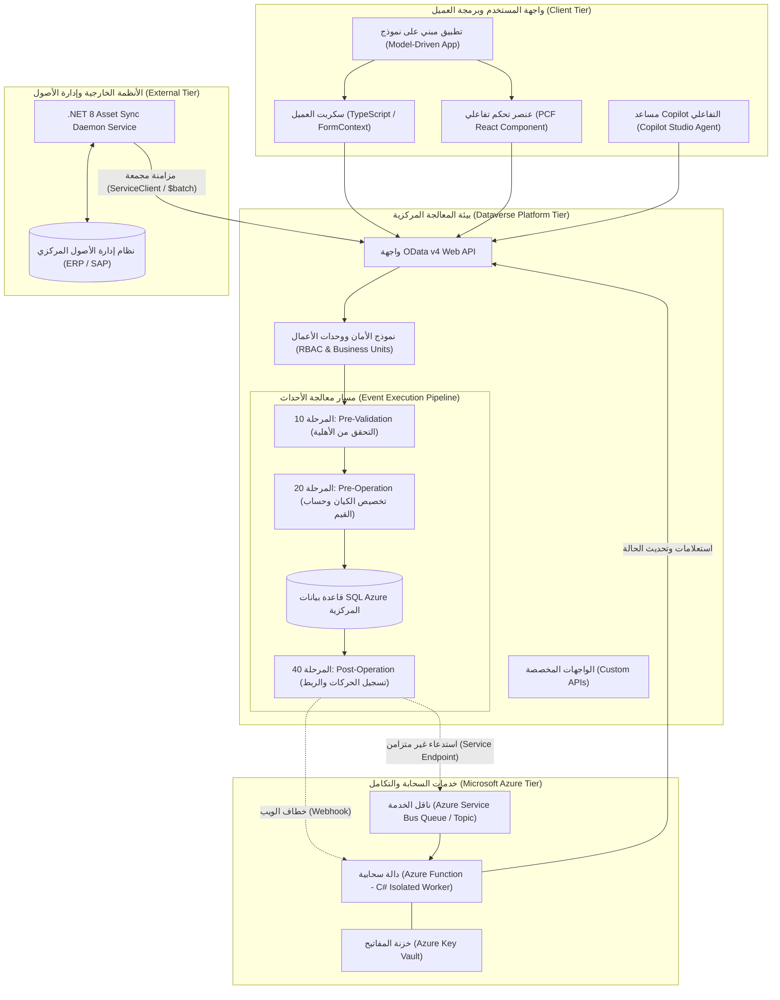
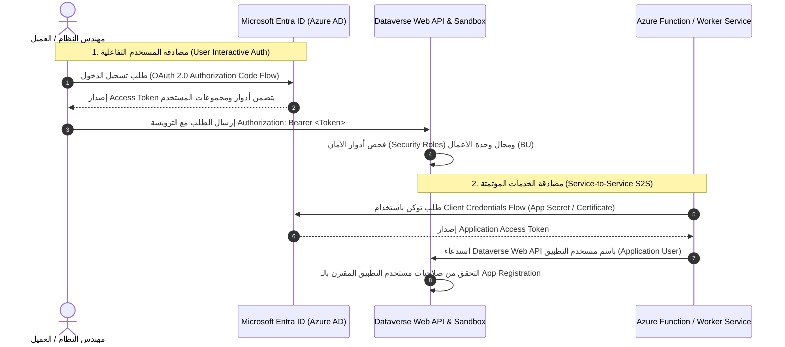

# المعمارية الشاملة لنظام إدارة وتخصيص المعدات
## Enterprise System Architecture & Component Interaction

توضح هذه الوثيقة المعمارية الفنية الشاملة لنظام **Equipment Provisioning & Asset Lifecycle Management System**، موضحة حدود التنفيذ (`Execution Boundaries`)، تدفق البيانات، ونموذج الأمان والتكامل بين مكونات المنصة السحابية وتقنيات **.NET / C#** و **Azure**.

---

## 1. مخطط المكونات وحدود المعالجة (Component Interaction Diagram)

---

## 2. حدود التنفيذ والبيئات المعزولة (Execution Boundaries)

### 1. بيئة المتصفح والعميل (Client Browser Boundary)
- **التقنيات**: TypeScript, React, Fluent UI v9, Dataverse Web API Client.
- **طبيعة المعالجة**: معالجة تفاعلية غير موثوقة أمنياً من جانب الخادم (`Untrusted Environment`).
- **المسؤولية**:
  - التحسين البصري لتجربة المستخدم (UI/UX).
  - التحقق المبدئي السريع من المدخلات لتقليل زمن الاستجابة.
  - لا يُعتمد عليها في فرض القيود المالية، الأمنية، أو التحقق من توفر المخزون الحرج.

### 2. بيئة المنصة المركزية وحاوية الخادم (Dataverse Execution Sandbox Boundary)
- **التقنيات**: C# (.NET Framework 4.6.2 / Dataverse Isolation Mode: Sandbox).
- **طبيعة المعالجة**: بيئة خادم مؤمنة ومعزولة تديرها مايكروسوفت جزئياً وتفرض حدوداً صارمة على الموارد:
  - أقصى مدة لتنفيذ الإضافة المتزامنة: **دقيقتان (120 ثانية)**.
  - منع الوصول المباشر لنظام الملفات، وسجل النظام (Registry)، أو منافذ الشبكة المحلية.
  - الاتصال الشبكي مسموح فقط عبر بروتوكولات HTTPS على المنافذ القياسية (443/80).
- **المسؤولية**:
  - فرض قواعد العمل الإلزامية التي لا يمكن تجاوزها حتى لو استُدعيت البيانات عبر واجهات برمجية خارجية.
  - ضمان سلامة المعاملة المتزامنة (`ACID Transaction Boundary`). إذا فشل تخصيص الجهاز أو تبين نفاذ المخزون، يتم التراجع عن كافة عمليات الحفظ (`Rollback`).

### 3. بيئة المعالجة السحابية الخلفية (Azure Isolated Serverless Boundary)
- **التقنيات**: .NET 8 (Isolated Worker Process), Azure Functions, Azure Service Bus.
- **طبيعة المعالجة**: خوادم حوسبة مرنة غير مقيدة بمهلة الـ 120 ثانية الخاصة بـ Dataverse Sandbox.
- **المسؤولية**:
  - المهام طويلة المدى (تجهيز أنظمة التشغيل، تفعيل تراخيص البرامج، إرسال خطابات العهدة الرسمية).
  - استهلاك الرسائل بنمط النشر والاشتراك (`Publish-Subscribe`) عبر Azure Service Bus.
  - إيقاف تشغيل ومحاولة إعادة إرسال الرسائل الفاشلة تلقائياً عبر طابور الرسائل التالفة (`Dead-Letter Queue`).

### 4. بيئة خدمات المزامنة الخلفية (.NET 8 Daemon Boundary)
- **التقنيات**: .NET 8 Background Worker Service, `Microsoft.PowerPlatform.Dataverse.Client` (`ServiceClient`).
- **طبيعة المعالجة**: تطبيق يعمل كخدمة بنظام Windows Service أو Linux Container داخل شبكة المؤسسة.
- **المسؤولية**:
  - مزامنة كشوفات الأجهزة المشتراة حديثاً من نظام الـ ERP إلى Dataverse.
  - استخدام طلبات الدفعات المجمعة (`ExecuteMultipleRequest` أو `$batch`) لتفادي تجاوز حدود طلبات API (`API Service Protection Limits`).

---

## 3. نموذج الأمان والمصادقة (Security & Identity Architecture)

### معايير الأمان المطبقة:
1. **مستخدم التطبيق (Application User)**: الربط البرمجي بين Azure و Dataverse لا يستخدم حسابات مستخدمين شخصية إطلاقاً، بل يستخدم `Dataverse Application User` مقترناً بتسجيل تطبيق في Entra ID (`App Registration`) مع تطبيق مبدأ الصلاحيات الأدنى (`Least Privilege`).
2. **حماية أسرار النظام**: تُخزن شهادات وسلاسل الاتصال حصرياً داخل `Azure Key Vault` ولا يتم كتابة أي سر برمجي داخل مستودع الأكواد (`Zero Secret in Code`).
3. **أمان مستوى الحقول (Column-Level Security)**: حقول التكلفة المالية والأرقام التسلسلية الحساسة تخضع لملفات أمان الحقول (`Field Security Profiles`) لمنع ظهورها إلا للمستخدمين المصرح لهم.
