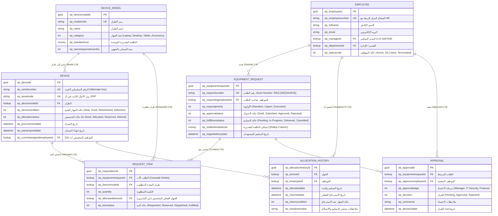

# نموذج البيانات ومخطط العلاقات العلائقية
## Relational Data Model, Schema & Entity-Relationship

تحدد هذه الوثيقة البنية الهيكلية لقاعدة البيانات المؤسسية لنظام **Equipment Provisioning & Asset Lifecycle Management System** المبني على **Microsoft Dataverse**، وتوضح الحقول، الأنواع، القيود، المفاتيح البديلة، وسلوكيات التعاقب (`Cascade Behaviors`).

بادئة التخصيص المعتمدة للحل المؤسسي: `ep_` (اختصار لـ *Equipment Provisioning*).

---

## 1. مخطط الكيانات والعلاقات (Entity-Relationship Diagram)

---

## 2. المفاتيح البديلة والتحسين المؤسسي (Alternate Keys & Performance)

في التطوير الاحترافي عبر C# و Web API، لا يعتمد المهندس على الاستعلام المسبق لجلب معرفات الـ GUID لكل عملية استيراد، بل يستخدم **المفاتيح البديلة (`Alternate Keys`)** لتنفيذ عمليات التحديث أو الإدراج السريعة (`Upsert`).

| الجدول (Entity) | اسم المفتاح البديل (Key Logical Name) | حقول المفتاح البديل | الفائدة المعمارية للربط والتكامل |
|---|---|---|---|
| `ep_device` | `ep_key_device_serialnumber` | `ep_serialnumber` | يتيح لخدمة مزامنة الأصول بـ .NET تحديث حالة الجهاز مباشرة باستخدام الرقم التسلسلي دون الحاجة لاستعلام تمهيدي (`Upsert by Serial`). |
| `ep_device` | `ep_key_device_assetcode` | `ep_assetcode` | مطابقة الأصل الثابت مع سجلات الحسابات ونظام ERP المؤسسي. |
| `ep_employee` | `ep_key_employee_number` | `ep_employeenumber` | مزامنة بيانات الموظفين مع نظام إدارة الموارد البشرية (Workday / SAP HR) مباشرة. |
| `ep_devicemodel` | `ep_key_model_code` | `ep_modelcode` | سرعة فهرسة وتصنيف الأجهزة عند استيراد الكتالوج العام. |

---

## 3. سلوكيات التعاقب والعلاقات (Relationship Cascade Behaviors)

ضبط سلوكيات العلاقات في Dataverse أمر جوهري لمنع تلف البيانات وضمان حماية السجلات المحمية بالقانون:

1. **العلاقة بين `ep_equipmentrequest` و `ep_requestitem` (علاقة أب وابن - Parental)**:
   - *النوع*: `1:N`
   - *سلوك الحذف (Delete)*: **Cascade All** (إذا حُذف مسودة الطلب الأساسي، تُحذف تلقائياً كافة بنود الطلب المرتبطة به).
   - *سلوك التعيين (Assign / Share)*: **Cascade All** (تنتقل ملكية البنود مع الطلب الأساسي تلقائياً).

2. **العلاقة بين `ep_device` و `ep_requestitem` (علاقة مرجعية - Referential)**:
   - *النوع*: `1:N`
   - *سلوك الحذف (Delete)*: **Restrict Delete** (يُمنع منعاً باتاً حذف سجل الجهاز إذا كان مخصصاً لأي بند طلب تاريخي أو حالي، لضمان الحفاظ على السجلات المالية والأمنية).

3. **العلاقة بين `ep_device` و `ep_allocationhistory` (علاقة تتبع مرجعية)**:
   - *النوع*: `1:N`
   - *سلوك الحذف (Delete)*: **Restrict Delete** (يمنع حذف أصل الجهاز طالما أن له سجلات عهدة تاريخية).

---

## 4. أعمدة الحساب وأعمدة التجميع (Calculated & Rollup Columns)

1. **`ep_totalestimatedcost` في جدول `ep_equipmentrequest`**:
   - *النوع*: **Rollup Column** (عمود تجميعي).
   - *الصيغة*: تجميع مجموع (`SUM`) تكلفة بنود الطلب `ep_requestitem.ep_devicemodelid.ep_standardcost`.
   - *الفائدة*: يتيح لـ Dataverse ومسارات الموافقات معرفة إجمالي قيمة الطلب لتحديد مسار الاعتماد تلقائياً (مثلاً: إذا تجاوزت التكلفة 5,000 دولار تتطلب موافقة المدير المالي `Finance Approval`).

2. **`ep_iswarrantyactive` في جدول `ep_device`**:
   - *النوع*: **Calculated / Formula Column** (عمود صيغة بصيغة Power Fx).
   - *الصيغة*: `ep_warrantyenddate >= Now()`
   - *الفائدة*: تحديد فوري لما إذا كان الجهاز مشمولاً بالضمان دون الحاجة لتشغيل وظائف دورية في قاعدة البيانات.
